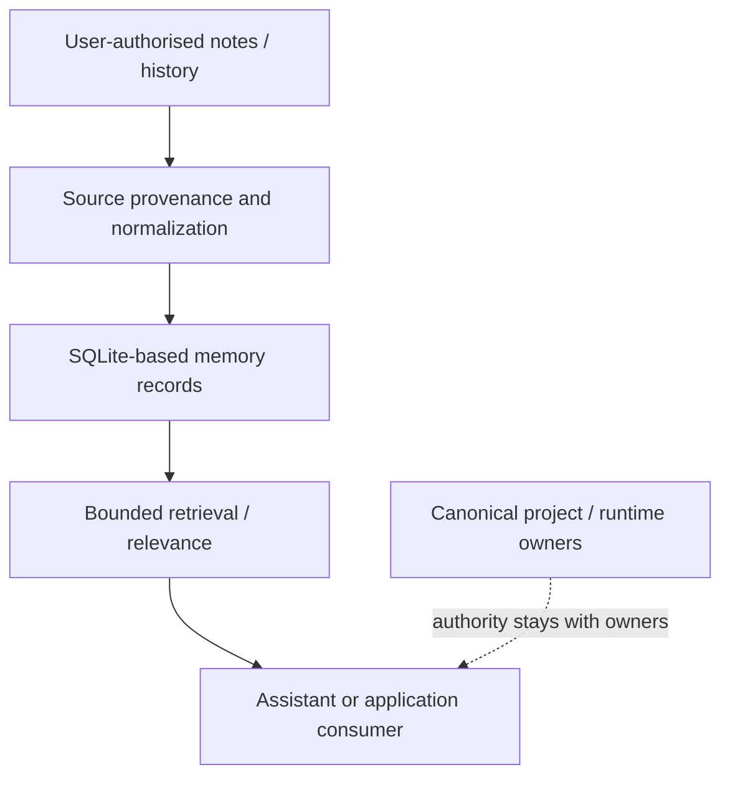

# Fork qualification notes — portable memory substrate

**Scope:** public source fork of Mnemosyne, a SQLite-backed low-dependency AI memory engine. Source reuse and experimental integration are separate from a live deployment.

This research lane evaluates lightweight, portable, local-first memory primitives, potentially useful alongside Obsidian, explicit history graphs and user-governed continuity. A memory engine stores/retrieves records; it does not become a task ledger, model identity source, runtime governor or self-authorizing executor.

**Evaluation matrix:** source identity and version; import provenance and privacy; insert/update/idempotency behavior; cross-session query correctness; sensitive-record exclusion; export/rollback; resource footprint; integration with one explicit consumer; and negative tests for unauthorized context/authority promotion.

No claim is made that a public Mnemosyne fork alone reconstructs complete ChatGPT history or integrates with any deployed owned application. Preserve upstream MIT license and copyright; avoid embedding private notes or archive exports in tests and examples.
